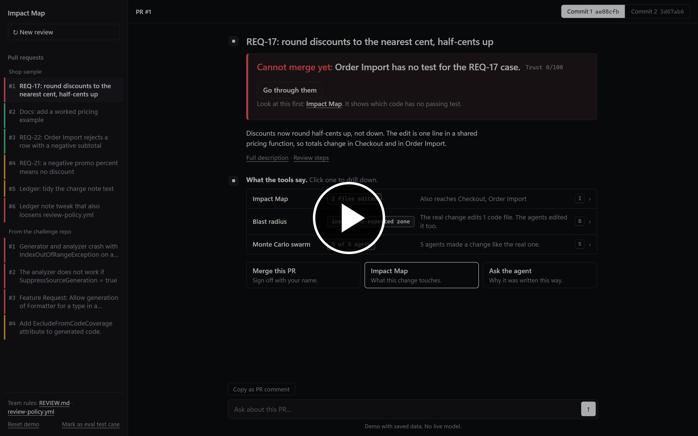
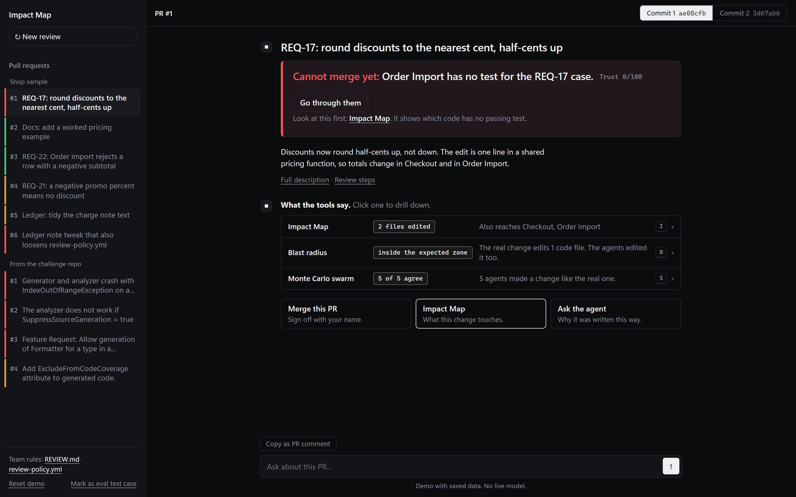
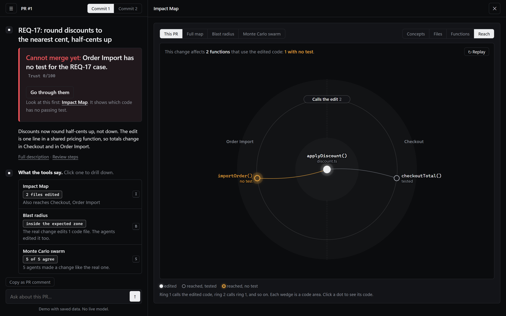
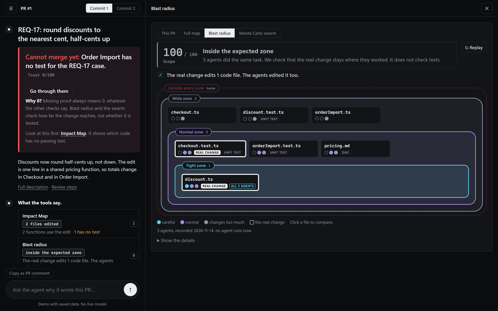

# Impact

**See what an AI-written pull request really touches, and sign off only on what was checked.**

[](VIDEO_URL)

[Live demo](https://impact--map.modal.run) · [Explainer (PDF)](docs/explainer.pdf) · [Pitch video](VIDEO_URL)

Built for Junction 2026, Tieto challenge *Earned Trust in AI Code*.

## What it does

A normal pull request shows the lines that changed. Impact shows what those lines reach, and what
the tests really prove.

- **A verdict first.** One plain sentence: can this merge, and if not, why. Here: Order Import uses
  the edited pricing code and has no test for the new case.
- **Impact Map.** Which functions call the edited code, which of them a test reaches, and which do
  not. Code outside the diff is shown, not hidden.
- **Blast radius and Monte Carlo swarm.** The same task was given to several AI agents. If the real
  change edits code none of them touched, or does more than they did, it gets a question.
- **Too much, too little.** Each edit is taken out again to see if any test notices. Edits nobody
  needs, and old code the change left behind, get a question.
- **A named sign-off.** A person signs off on one exact commit. A new commit needs a new sign-off.

It runs on two sets of pull requests: six in a small TypeScript shop sample built by this project,
and four real AI-written pull requests from Tieto's C# sample repository (MessagePack-CSharp).







## Why you can trust it

- **Rules decide.** Severity and route (merge, human review, or wait for checks) come from fixed
  rules and the team's policy file, read from the base commit. A pull request cannot change the
  rules it is judged by.
- **The AI can only send a change to a person.** The AI reviewer's findings can raise severity or
  keep a change away from auto-merge. They can never lower either. `npm run brake` feeds every kind
  of reviewer answer (silent, wrong, broken, made up, for another change) into every demo commit to
  check this.
- **Attacks become tests.** Every way we found to sneak a change onto the auto-merge route is a
  permanent test, from a docs edit that code reads its prices from
  ([docs/negative-price-attack.md](docs/negative-price-attack.md)) to instructions to the AI hidden
  in a comment ([docs/hidden-instructions.md](docs/hidden-instructions.md)).
- **A person signs one exact commit.** A sign-off names the person and the commit, and is never
  edited. `npm run gate` passes only when the latest commit is signed off. Nothing is merged for real.

## Run it

Needs Node 22.6 or newer and Git. No model access or API key needed.

```
npm ci
npm run setup
npm start
```

Then open <http://localhost:4317>. `npm run setup` rebuilds the sample Git repository and reuses the
saved evidence in `data/` (test runs, code index, AI reviews, agent runs).

To record fresh evidence instead: `npm run setup:fresh` re-runs the tests, Graphify and the edit check
on every commit (needs Graphify: `uv tool install graphifyy==0.9.108 --python 3.12`), and `npm run review:live`
re-runs the AI review (needs the `claude` CLI, signed in).

### Hosted demo

`deploy/modal_app.py` hosts the app on [Modal](https://modal.com) (`modal deploy deploy/modal_app.py`).
It serves the saved evidence and never calls a model. In public demo mode (`PUBLIC_DEMO=1`) visitors
can click through everything; a sign-off is checked by the server as usual but kept in the visitor's
own browser, and each address gets 600 requests a minute.

## Tests

```
node evals/run.mjs          # review evals
node evals/fast-lane.mjs    # attempts to reach auto-merge that must be held
npm run -s brake            # AI reviewer answers that must never lighten the route
node evals/edit-check.mjs   # the "too much, too little" check on known cases
```

At the time of writing: 160 of 160 evals pass, 92 of 92 attempts are held, 7,217 of 7,217 brake
checks pass, and all 24 edit-check cases come out as expected.

## How it's built

- [src/server.mjs](src/server.mjs): a small Node server with no framework. [src/public/](src/public/)
  is the web app (plain JavaScript; the map graph is a prebuilt React Flow bundle from
  [src/graph/main.jsx](src/graph/main.jsx)).
- [src/lib/model.mjs](src/lib/model.mjs) builds one review from the diff, the code index
  (Graphify for TypeScript, Roslyn for C#), recorded test runs on base and head, and the AI review.
- [src/lib/classifier.mjs](src/lib/classifier.mjs) and [src/lib/claims.mjs](src/lib/claims.mjs):
  the fixed rules for severity, route and claims. [src/lib/verdict.mjs](src/lib/verdict.mjs): the
  one-sentence verdict.
- [src/lib/reviewer.mjs](src/lib/reviewer.mjs): the independent AI reviewer, Claude Sonnet 5.5 in a
  fresh process with no tools. Its answers are saved in `data/reviews/` and replayed.
- [src/lib/blast.mjs](src/lib/blast.mjs), [src/lib/swarm.mjs](src/lib/swarm.mjs),
  [src/lib/edit-check.mjs](src/lib/edit-check.mjs), [src/lib/reach.mjs](src/lib/reach.mjs): the
  tools. The agent runs were recorded once by the scripts in [scripts/](scripts/); the demo replays them.
- [docs/](docs/): [concept card](docs/concept-card.md), [decisions](docs/decisions.md),
  [lessons log](docs/lessons-log.md), [planted-fault measurement](docs/measurement.md),
  [reviewer agreement](docs/reviewer-agreement.md).

## Data and licence

- The shop sample is made up for this demo and built from [sample/](sample/).
- [data/tieto/](data/tieto/) holds recorded review data for the real Tieto pull requests, including
  excerpts of MessagePack-CSharp (MIT). See [data/tieto/NOTICE.upstream.md](data/tieto/NOTICE.upstream.md).
- [vis-network](src/public/vendor/vis-network/) is included under its own licence.
- Everything else: [MIT](LICENSE).
